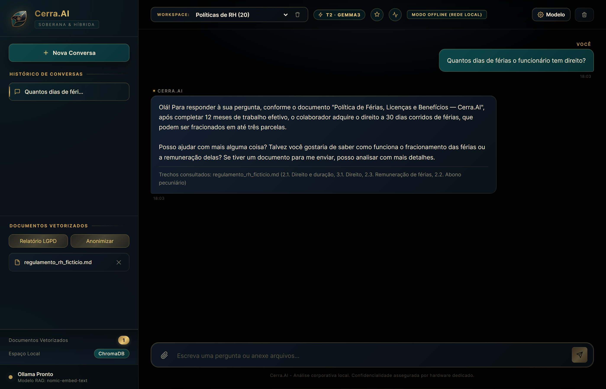

# Cerra.AI

**Assistente corporativo 100% local para Windows.** Converse com os documentos da sua empresa sem enviar nada para a nuvem: modelos de linguagem no Ollama, base vetorial no seu computador e auditoria LGPD local.

[](https://github.com/renato0503/cerraai-publico/releases/latest)
[](#requisitos)
[](#privacidade-e-lgpd)
[](LICENSE)

<p align="center">
  
</p>

<p align="center">
  
</p>

## Download

O executável oficial está na página de **Releases**:

**[Baixar a versão mais recente](https://github.com/renato0503/cerraai-publico/releases/latest)**

| Arquivo | Para que serve |
| :--- | :--- |
| `Cerra.AI.exe` | Aplicativo completo (Windows 64 bits). Não precisa instalar. |
| `Cerra.AI-Instalar-Modelos.bat` | Baixa uma única vez os modelos de IA usados pelo aplicativo. |
| `SHA256SUMS.txt` | Hash oficial do executável, para conferir a integridade do download. |

> Este repositório distribui o **executável oficial**. O código-fonte não faz parte desta versão pública.

## O que ele faz

- **Responde com base nos seus documentos** — PDF (inclusive digitalizado), Word, Excel, PowerPoint, CSV, ODT, HTML, TXT/MD, imagens e áudio/vídeo são convertidos em texto e indexados localmente.
- **Workspaces isolados** — separe bases por setor ou assunto. Já vêm prontos os cenários de **Contabilidade**, **Oncologia** e **Advocacia Penal**, cada um com sua base de referência e limites éticos.
- **Privacidade por padrão** — nenhum documento, pergunta ou resposta sai do computador. Sem telemetria, sem login e sem nuvem.
- **LGPD na prática** — botões de **Relatório LGPD** e **Anonimizar**, que mascaram dados pessoais antes de qualquer processamento pelo modelo, além de trilha de auditoria local.
- **Modelos locais com roteamento automático** — o aplicativo escolhe o modelo adequado para cada pergunta e mantém a conversa em streaming.
- **Painel administrativo e monitor de desempenho** — auditoria, gestão de documentos e métricas de tempo de resposta.
- **Aplicativo desktop nativo** — janela própria, sem precisar abrir navegador.

## Requisitos

| Item | Mínimo | Recomendado |
| :--- | :--- | :--- |
| Sistema | Windows 10 ou 11, 64 bits | Windows 11, 64 bits |
| Memória RAM | 8 GB | 16 GB ou mais |
| Espaço em disco | 10 GB livres | 20 GB livres |
| Placa de vídeo | Não obrigatória (roda na CPU) | NVIDIA com 8 GB de VRAM |
| Software | [Ollama para Windows](https://ollama.com/download/windows) | Ollama atualizado |

Não é necessário ter privilégios de administrador. O aplicativo usa a pasta do usuário para guardar dados.

## Instalação

### 1. Instale o Ollama

Baixe e instale o Ollama: <https://ollama.com/download/windows>

Para conferir se a instalação funcionou, abra o Prompt de Comando e execute:

```bat
ollama --version
```

### 2. Baixe o Cerra.AI

Na página de [Releases](https://github.com/renato0503/cerraai-publico/releases/latest), baixe:

- `Cerra.AI.exe`
- `Cerra.AI-Instalar-Modelos.bat`

Coloque os dois arquivos em uma pasta de sua preferência, por exemplo `C:\Cerra.AI`.

### 3. Baixe os modelos de IA (uma única vez)

Com internet disponível, **execute `Cerra.AI-Instalar-Modelos.bat`** e aguarde. Ele baixa:

| Modelo | Tamanho aproximado | Função |
| :--- | ---: | :--- |
| `nomic-embed-text` | 0,3 GB | Busca nos documentos |
| `qwen2.5:1.5b` | 1 GB | Respostas rápidas |
| `gemma3` | 3,3 GB | Modelo principal (também entende imagens) |

Total: cerca de **4,6 GB**. Depois disso, o Cerra.AI funciona sem internet.

O instalador oferece ainda o **perfil completo** (`llama3.1:8b` e `gemma4`, cerca de 10 GB adicionais), indicado para computadores com GPU de 8 GB ou mais.

### 4. Abra o Cerra.AI

Dê um duplo clique em **`Cerra.AI.exe`**. A janela do aplicativo abre automaticamente.

Na primeira execução, o Windows pode exibir o aviso **"O Windows protegeu o seu PC"** porque o executável ainda não tem assinatura digital comercial. Clique em **Mais informações** e depois em **Executar assim mesmo**. Se preferir, confira antes o hash SHA-256 do arquivo (veja [Integridade do download](#integridade-do-download)).

## Como usar

1. **Escolha o workspace** no topo da tela (por exemplo, *Contabilidade*) ou use o workspace padrão.
2. **Anexe documentos** pelo clipe na caixa de mensagem. O arquivo é convertido e indexado localmente.
3. **Faça a pergunta** normalmente. A resposta cita os trechos consultados.
4. Use **Relatório LGPD** para gerar um relatório com os dados pessoais mascarados, ou **Anonimizar** para mascarar um texto ou arquivo sem indexá-lo.
5. Na engrenagem **Modelo**, escolha entre o modo automático e um modelo específico.

### Formatos aceitos nos anexos

PDF com texto ou digitalizado (OCR), DOCX, XLSX, PPTX, CSV, ODT, HTML, TXT, MD, imagens (PNG, JPG e outras) e áudio/vídeo (transcrição local com Whisper).

### Atalhos úteis

| Atalho | Ação |
| :--- | :--- |
| `Ctrl + Enter` | Enviar a mensagem |
| `Esc` | Fechar menus e janelas abertas |

## Privacidade e LGPD

- **Processamento local:** perguntas, documentos, embeddings e respostas ficam na sua máquina. O aplicativo não envia dados para servidores externos.
- **Sem cadastro:** o modo público é offline e usa o usuário local como administrador.
- **Sem telemetria:** não há coleta de uso, analytics ou rastreamento.
- **Auditoria:** as operações relevantes são registradas em `audit.log`, no próprio computador.
- **Controle sobre os documentos:** é possível remover um documento do workspace e apagar seus vetores pelo painel administrativo.
- **Modo remoto e Freedom Tier não fazem parte desta versão pública.** O acesso remoto via túnel, o login Firebase e os modelos sem filtro ficam desativados.

> O Cerra.AI é uma ferramenta de apoio. Respostas geradas por IA podem conter erros. Confira informações críticas antes de tomar decisões.

## Onde ficam os dados

| Conteúdo | Local |
| :--- | :--- |
| Conversas, bases vetoriais e configurações | `%LOCALAPPDATA%\Cerra.AI\data` |
| Logs e auditoria | `%LOCALAPPDATA%\Cerra.AI\logs` |
| Modelos de IA | Pasta do Ollama (gerenciada pelo próprio Ollama) |

Para **fazer backup**, feche o aplicativo e copie a pasta `%LOCALAPPDATA%\Cerra.AI`.

Para **atualizar**, baixe o novo `Cerra.AI.exe`, substitua o arquivo antigo e abra novamente. Seus dados são preservados.

Para **desinstalar**, feche o aplicativo, apague o `Cerra.AI.exe` e a pasta `%LOCALAPPDATA%\Cerra.AI`. Se quiser remover também os modelos, use `ollama rm <modelo>`.

## Integridade do download

Cada release publica o arquivo `SHA256SUMS.txt`. Para conferir o executável no Windows, abra o PowerShell na pasta do arquivo e execute:

```powershell
Get-FileHash .\Cerra.AI.exe -Algorithm SHA256
```

O hash exibido deve ser idêntico ao registrado no `SHA256SUMS.txt` da release.

## Solução de problemas

**O aplicativo abre, mas a IA não responde.**
Confirme que o Ollama está instalado (`ollama --version`). O Cerra.AI tenta iniciá-lo automaticamente; se não encontrar o programa, avise nas configurações ou reinstale o Ollama.

**Aparece a mensagem de que faltam modelos.**
Execute novamente o `Cerra.AI-Instalar-Modelos.bat`. O que já foi baixado não é baixado outra vez.

**A porta 5050 já está em uso.**
Feche outra instância do Cerra.AI ou o programa que estiver usando essa porta e abra o aplicativo novamente.

**O Windows ou o antivírus bloqueou o executável.**
Executáveis empacotados com PyInstaller às vezes são sinalizados por engano. Confira o SHA-256, permita o arquivo no antivírus e, se necessário, adicione a pasta do Cerra.AI às exceções.

**As respostas estão lentas.**
Verifique se o Ollama está usando a GPU. Em computadores sem GPU, o processamento ocorre na CPU e pode levar mais tempo. O monitor de desempenho mostra o tempo até a primeira palavra.

**Um PDF digitalizado não foi lido.**
O OCR é executado localmente e pode levar alguns segundos por página. Aguarde a conclusão do upload antes de perguntar.

## Tecnologia

O Cerra.AI combina componentes que rodam inteiramente na máquina do usuário:

- [Ollama](https://ollama.com/) para execução dos modelos de linguagem
- [ChromaDB](https://www.trychroma.com/) para a base vetorial por workspace
- FastAPI e Uvicorn no backend local
- SQLite para conversas e configurações
- pywebview para a janela desktop nativa
- RapidOCR e faster-whisper para OCR e transcrição offline

## Escopo e limitações desta versão

- Disponível apenas para **Windows 64 bits**.
- Uso **individual e local**; esta versão não inclui compartilhamento remoto, login multiusuário nem túnel de acesso.
- Modelos sem filtro (Freedom Tier) não são distribuídos nem habilitados.
- O aplicativo não substitui orientação jurídica, contábil, médica ou de segurança da informação.

## Suporte

Encontrou um problema ou tem uma sugestão? Abra uma [issue](https://github.com/renato0503/cerraai-publico/issues) descrevendo:

- versão do Windows;
- versão do Cerra.AI (release baixada);
- o que você esperava e o que aconteceu;
- mensagem de erro, se houver.

Não anexe documentos com dados pessoais reais nas issues.

## Licença

Distribuído sob a licença MIT. Veja [LICENSE](LICENSE).
